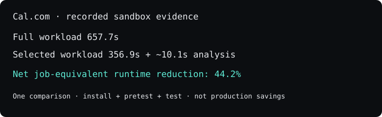

# DiffCI Core

[](https://mcprush.com/to/diffci-mcp?ref=badge)

**Open-source test-impact analysis for faster CI.** For developers and maintainers evaluating which tests a change affects, with conservative full-run fallbacks. Licensed under the MIT License.

## Coding-agent plugins

The public [`integrations/agent-plugin`](integrations/agent-plugin) package
makes the published DiffCI CLI available as a checkout-aware local MCP plugin.
It contains only public marketplace metadata, skills, and a pinned npm
launcher; it does not include product services or private source. The
[cross-agent installation guide](docs/agent-installation.md) covers Codex,
Claude Code, Cursor, Grok, Meta Muse Code, and generic MCP hosts.

```sh
# Codex
codex plugin marketplace add DiffCI/core
codex plugin add diffci@diffci-local

# Claude Code
claude plugin marketplace add DiffCI/core
claude plugin install diffci@diffci-marketplace
```

Cursor Marketplace reads [`.cursor-plugin/marketplace.json`](.cursor-plugin/marketplace.json)
from this repository. Meta Muse Code reads the native root
[`marketplace.json`](marketplace.json). Before a public listing is approved,
use the local MCP configuration in the agent-plugin package or visit
https://diffci.com/mcp-server.

## GitHub Action

The public [`action.yml`](action.yml) is an observation-only GitHub Action
wrapper. It runs the pinned published DiffCI CLI outside the observed checkout,
retains existing CI jobs, and uploads an advisory report. See the
[observer Action guide](docs/github-action-observer.md) and
[workflow example](examples/github-actions-observer.yml).

The [v0.3.10 corresponding source](https://github.com/DiffCI/core/tree/4c76be14cec37d94eb7df93922f3c29d202f4e65/packages/diffci-cli)
remains publicly available at tagged Core commit `4c76be14` (`cli-v0.3.10-source`)
while distribution migrates to the Core-native CLI package.

Try the published CLI in an existing Git checkout with Git and Node.js 22.5+:

```sh
npx "@diffci.com/diffci@latest" check
```

It compares full and selected runtime when safe to measure, writes reports outside the checkout, and sends nothing by default. Test commands can generate files; keep required CI authoritative.

**Measured example:** one controlled Cal.com sandbox replay measured **44.2% net reduction** in install + pretest + test runtime including analysis overhead. This is a job-equivalent comparison, not production savings or a forecast for your repository. [Method and limitations](https://diffci.com/case-studies/calcom).



[Star Core](https://github.com/DiffCI/core) · [Volunteer a pilot repository](https://diffci.com/#pilot) · [Find a first contribution](https://github.com/DiffCI/core/issues?q=is%3Aopen+label%3A%22good+first+issue%22).
Watch → Custom → Releases and Discussions for benchmark results and support updates. [Public roadmap](docs/roadmap.md).

This is the standalone Core engine. It analyzes local JavaScript/TypeScript repositories, supported Vue components, root Go modules and conventional Maven reactors, traces dependency impact, infers GitHub Actions structure and proposes test selections with evidence and full-run fallbacks. It works without a DiffCI account, hosted service or API key. See [the release boundary](docs/release-boundary.md) for support limits.

**Want to try DiffCI in an existing repository?** Use the published CLI: `npx @diffci.com/diffci@latest check`. See [the CLI quickstart](docs/using-diffci.md) for a no-execution analysis option, prerequisites, and result interpretation. The commands below build the standalone engine from source.

## Run locally

Requires Git and Node.js 22.5 or later.

```sh
git clone https://github.com/DiffCI/core.git
cd core
npm ci
npm run build
npm test
node dist/cli.js plan --repo /path/to/clean-checkout --base HEAD~1 --head HEAD
```

The target must be a clean Git repository root checked out at `--head`. Fetch the base commit beforehand if using a shallow clone. JSON goes to stdout; analysis errors exit nonzero and recommend full CI. Core does not execute repository scripts, contact a DiffCI backend or send telemetry. Installation requires the npm registry.

To evaluate the same command on pull requests without changing required jobs, copy the [advisory GitHub Actions example](examples/README.md).

**Plans are advisory.** This release does not execute, skip or cancel CI jobs. `SKIP_CANDIDATE` is a candidate, not permission to bypass a check. Keep full CI authoritative while evaluating Core. Missing command synthesis, unsupported configuration and incomplete evidence must not be treated as an empty test suite. Static analysis is not proof that a test can safely be omitted.

For Maven jobs whose CI runs a lifecycle goal or profiles other than `test`, declare them in `diffci.json` (or the `diffci` key in `package.json`):

```json
{ "maven": { "goal": "verify", "profiles": ["run-its"] } }
```

This changes the proposed command, such as `mvn -pl tools -am verify -P run-its`; Core still does not run it. Confirm the command against the repository's CI workflow before using it for execution.

## What is included

Declared pnpm workspaces with a single Vitest test phase can receive package-local command plans. Each selected path must belong to a discovered test in a declared package. Runtime selections are batched to keep commands below Windows limits; packages declaring `--typecheck` retain a separate full type-test phase. Packages with compound scripts, lifecycle hooks, overlapping ownership or discovery blind spots refuse selective execution. Commands remain advisory and must be executed separately; CLI automatic timing of multiple commands requires additional integration.

| Area | Implementation |
| --- | --- |
| Changes and dependencies | Git deltas, repository inventory, JS/TS dependency graph, impact traversal |
| Safety and planning | Risk signals, conservative fallback, always-run policy, test selection and command synthesis |
| CI analysis | GitHub Actions evidence, job/reference graphs, conditions and matrix inference |
| Reproducible evaluation | Synthetic benchmark and portable regression tests |
| Measurement | Current-process wall time, CPU time and ending RSS; explicit-input cost/energy/carbon estimates |

The library entry point exports `analyzeCheckout`, `buildDependencyGraph`, `ImpactAnalyzer`, `DefaultCIPlanner`, `collectEvidence`, `inferPipeline`, `measure` and `estimateImpact`. Lower-level modules are available as package subpaths. This repository is the engine source, and the published [`@diffci.com/diffci` CLI](https://www.npmjs.com/package/@diffci.com/diffci) is released from it. The corresponding source for the previously published v0.3.10 package is retained in the [source archive at tagged commit `4c76be14`](https://github.com/DiffCI/core/tree/4c76be14cec37d94eb7df93922f3c29d202f4e65/packages/diffci-cli).

```sh
npm run typecheck
npm run audit:boundary
npm run benchmark
```

The benchmark constructs one temporary synthetic repository containing 100 chained modules and 100 importing test files. In one Node.js process it builds that same dependency graph three times, sequentially, and removes the fixture afterward. Install dependencies first with `npm ci`, then run `npm run benchmark` under Node.js 22.5 or later. Record the emitted `node` and `platform` alongside the machine CPU, memory, operating system, and competing workload when comparing runs. The three builds share process, operating-system, and compiler warmup effects; they are not independent repetitions with controlled cold caches.

Each entry in `runs` has these fields:

| Field | Interpretation |
| --- | --- |
| `basis: "measured"` | The process counters were observed rather than estimated. |
| `scope: "current-process"` | Only the benchmark's Node.js process is covered, not the whole host, container, or CI job. |
| `wallSeconds` | Elapsed wall-clock time around one `buildDependencyGraph` call. |
| `cpuSeconds` | User plus system CPU time consumed by the current process during that call; it can differ from wall time. |
| `rssBytesAtEnd` | Resident-set size sampled after the call. It is neither peak memory nor the memory allocated by that call alone. |
| `nodes`, `edges` | Graph size. The current fixture should produce 200 nodes and 199 dependency edges. |
| `confidence` | Dependency-graph confidence for this synthetic fixture. `COMPLETE` does not prove that a real repository can safely skip tests. |

For example, `wallSeconds: 0.79`, `cpuSeconds: 0.84`, and `rssBytesAtEnd: 327868416` mean that one graph build elapsed for about 0.79 seconds, consumed about 0.84 current-process CPU seconds, and ended with roughly 328 MB RSS. They do **not** mean that CI became 0.79 seconds faster or saved 328 MB. The script does not execute tests, installation, builds, or a full-versus-selected comparison, so its timings must not be reported as CI savings.

The separate `estimateImpact` API can calculate `estimatedUsd`, `estimatedKwh`, and `estimatedKgCo2e` only from caller-supplied `computeSeconds`, price, power, and grid-intensity assumptions. Those values have `basis: "estimated"`; they are modeled scenarios, not benchmark output, physical measurements, billing records, or verified avoided emissions.

## Sponsors

DiffCI Core is supported by its [GitHub Sponsors](https://github.com/sponsors/DiffCI). Sponsorship funds maintenance, broader language and CI support, and reproducible benchmarks.

### Partners

No Partner sponsors yet. [Become the first](https://github.com/sponsors/DiffCI).

### Team Sponsors

No Team Sponsors yet. Team Sponsor logos also appear on [diffci.com/sponsors](https://diffci.com/sponsors).

### Backers

No Backers yet. Backers at $25/month or above are listed here.

Sponsors' bug reports are labelled [`sponsor`](https://github.com/DiffCI/core/labels/sponsor) and triaged first.

## Core and Cloud

| Component | Availability | License |
| --- | --- | --- |
| This Core repository | Public source | MIT |
| DiffCI Cloud: hosting, billing, organization management, dashboard, managed services | Private source | Proprietary; not included here |
| Optional enterprise modules | Not released here | A separate source-available license would apply if offered |

Only the explicitly extracted Core files and standalone tooling are in this repository. There is no private monorepo history, customer data, deployment configuration or Cloud implementation here. Core is usable independently; it is not a promise that the private product has already migrated to consume this package.

## License and contributions

See [LICENSE](LICENSE), [NOTICE](NOTICE) and [CONTRIBUTING.md](CONTRIBUTING.md). Releases before the MIT switch were published under AGPL-3.0-only and are now also available under MIT; see [LICENSE-HISTORY.md](LICENSE-HISTORY.md). Grant eligibility depends on the particular grant agreement. No eligibility or legal separation is guaranteed by this repository layout.

See [the release boundary](docs/release-boundary.md) for scope and current limitations.

Useful? [Star the engine](https://github.com/DiffCI/core) and [share a reproducible pilot result](https://diffci.com/#pilot).
